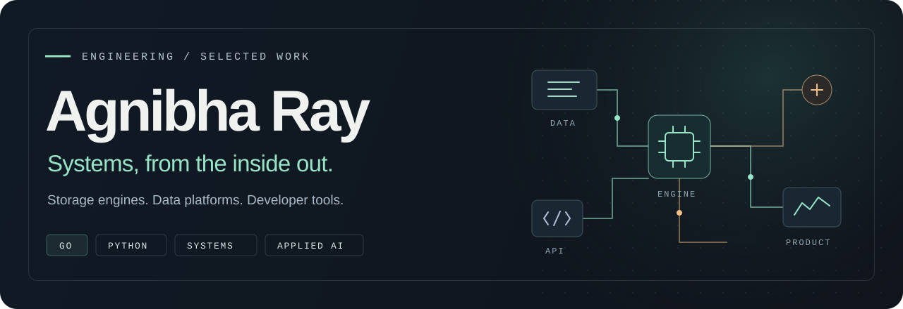
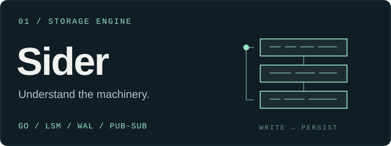
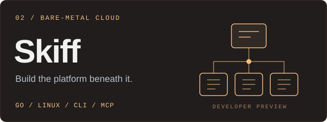
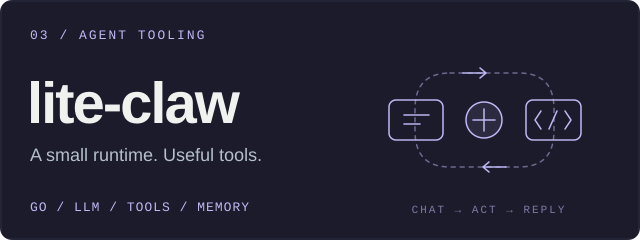
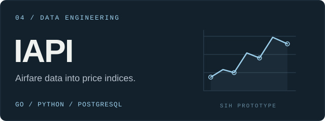

  

  <a href="#selected-projects">Projects</a> &nbsp; / &nbsp;
  <a href="#engineering-in-practice">Engineering</a> &nbsp; / &nbsp;
  <a href="#tools-of-the-trade">Stack</a> &nbsp; / &nbsp;
  <a href="mailto:agnibharay.55@gmail.com">Say hello ↗</a>

I build **storage engines, data platforms, developer tools, and the products around them**. Go and Python are my home base; TypeScript is how I bring the work to the screen.

At **BuySellTips Financial Research**, I work as a **Data Engineer — Financial Data Products (Alternative Finance)**. Outside work, I’m building my own database, a bare-metal cloud platform, and tools that put AI to work.

I like owning the whole path: understand the data, build the backend, design the interface, and get it running.

## Selected projects

<table>
<tr>
<td width="50%" valign="top">

### [Sider](https://github.com/AgnibhaRay/sider)

A persistent key-value store built around an **LSM tree**, with a write-ahead log, Bloom filters, SSTables, and compaction.

Durable TTL, Pub/Sub, prefix invalidation, and Python and Java clients take it beyond the storage internals into application caching and event delivery.

**Go · Storage internals · TCP · Client libraries**

[Source ↗](https://github.com/AgnibhaRay/sider) · [Project site ↗](https://siderdb.vercel.app)

</td>
<td width="50%" valign="top">

### [Skiff](https://www.skiffcloud.app)

A cloud platform on my own bare metal: a **Go control plane**, container deployments, tenant accounts, PostgreSQL, and S3-compatible object storage.

A web console, CLI, and MCP server bring the platform to developers and AI agents. **Developer preview; source is private.**

**Go · Linux · Containers · S3 · MCP**

[Project site ↗](https://www.skiffcloud.app) · [CLI & SDK ↗](https://www.npmjs.com/package/skiff-cloud)

</td>
</tr>
<tr>
<td width="50%" valign="top">

### [lite-claw](https://github.com/AgnibhaRay/lite-claw)

A lightweight **agent gateway in Go** that connects WhatsApp to Ollama and OpenAI-compatible models.

A tool-calling loop, file and shell tools, memory, and per-chat sessions make this an experiment in building a useful agent with a small runtime. **MVP.**

**Go · LLM tool use · Ollama · Messaging**

[Source & architecture ↗](https://github.com/AgnibhaRay/lite-claw)

</td>
<td width="50%" valign="top">

### [IAPI](https://github.com/AgnibhaRay/IAPI)

An **India Airfare Price Index** prototype for SIH 2026: source quotes become route-level Jevons indices and a weighted Laspeyres aggregate.

Go owns the API and index engine; Python handles source adapters. A Next.js dashboard supports quote review, recompilation, and audit trails. **SIH prototype; not an official MoSPI product.**

**Go · Python · PostgreSQL · Next.js**

[Source & methodology ↗](https://github.com/AgnibhaRay/IAPI) · [Demo ↗](https://iapi-rho.vercel.app)

</td>
</tr>
</table>

### Products, too

- **[Hand2Mart](https://hand2mart.vercel.app)** — a vehicle marketplace prototype combining a Go agent engine with buyer/seller conversations, vehicle comparison, chat, and booking workflows.
- **[Connecto](https://github.com/AgnibhaRay/connecto)** — a social product with feeds, stories, real-time chat, events, and moderation, built with Next.js, TypeScript, and Firebase.
- **[NutriScan](https://github.com/AgnibhaRay/NutriScan)** — a SwiftUI food-scanning app using Gemini for ingredient, nutrition, and freshness estimates, with Firebase-backed scan history.
- **[NSEC election platform](https://github.com/AgnibhaRay/nsec-eco-cultural-club-election)** — an EVM-inspired voting interface, election controls, and an authenticated administration flow, built with Next.js and Supabase.

## Engineering in practice

My professional work connects financial research to working software:

- **Data pipelines:** source ingestion, entity matching, validation, and reproducible CSV/Parquet exports.
- **Research systems:** evidence-backed company data, sentiment workflows, provenance, and point-in-time history.
- **Backend delivery:** Go and Python APIs, authentication, audit trails, and integration checks.
- **Cloud operations:** Terraform, AWS ECS, GitHub Actions, OIDC, HTTPS, and deployment health checks.

The part I enjoy most is making those layers agree: the API, the stored data, and the deployed service should tell the same story.

## Tools of the trade

**Core languages** &nbsp; Go · Python · TypeScript · SQL 
**Backends & data** &nbsp; FastAPI · Node.js · PostgreSQL · S3 · Pandas 
**Infrastructure** &nbsp; AWS · Terraform · Docker · GitHub Actions · Linux 
**Product surfaces** &nbsp; Next.js · React · SwiftUI · Firebase 
**AI tooling** &nbsp; Tool-calling agents · Ollama · MCP · Model APIs

---

  <b>Interested in storage engines, developer tools, or useful AI systems?</b>  
  <a href="mailto:agnibharay.55@gmail.com">Email</a> &nbsp; · &nbsp;
  <a href="https://x.com/2006_mrx">X</a> &nbsp; · &nbsp;
  <a href="https://www.instagram.com/agnibharay/">Instagram</a> &nbsp; · &nbsp;
  <a href="https://github.com/AgnibhaRay?tab=repositories">More projects ↗</a>

